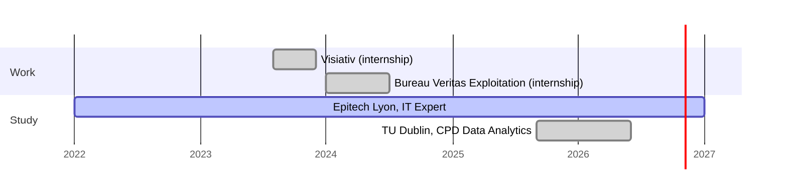

  

  
  
  
  
  

---

### 🎯 At a glance

- **Looking for:** **End-of-studies internship** (*stage de fin d'études*) in **Big Data, Data Engineering or AI**
- **Available:** From **March 2027**
- **Location:** Lyon, France
- **Studying:** Epitech Lyon, IT Expert (RNCP level 7), 2022–2027 · TU Dublin, CPD in Data Analytics
- **Experience:** 2 internships: Bureau Veritas Exploitation (data & compliance) · Visiativ · currently working part-time alongside my studies

I build the path data takes from a raw source to a decision: ingestion, streaming, storage, analysis and the dashboards or tools people act on.

---

### 🛠️ Featured work

Each project has a full write-up on [mcoulet.com](https://www.mcoulet.com): problem, architecture, decisions and trade-offs.

<table>
  <tr>
    <td width="50%" valign="top">
      
      <h4><a href="https://www.mcoulet.com/projects/aether">Aether Data</a> · search engine</h4>
      
Distributed search engine. Scraped pages flow through two Kafka topics and a Python sanitisation stage into Cassandra. Queries go through an AI ranking stage. PostgreSQL holds users and roles. Grafana tracks logs.

      

        
        
        
        
        
      

      <a href="https://www.mcoulet.com/projects/aether">Case study</a> · <a href="https://github.com/Djangss/Aether-DATA">Source</a>
    </td>
    <td width="50%" valign="top">
      
      <h4><a href="https://www.mcoulet.com/projects/area">AREA</a> · automation platform</h4>
      
IFTTT-style platform linking six services (GitHub, Google, Microsoft, Spotify, Twitch, Discord). A Go/Gin server dispatches workflows through RabbitMQ action and reaction queues. OAuth2 + TOTP auth, MariaDB, Docker, CI/CD.

      

        
        
        
        
        
      

      <a href="https://www.mcoulet.com/projects/area">Case study</a> · <a href="https://github.com/ASM-Studios/AREA">Source</a>
    </td>
  </tr>
  <tr>
    <td width="50%" valign="top">
      <h4><a href="https://www.mcoulet.com/projects/clausier">Clausier</a> · compliance tool @ Bureau Veritas</h4>
      
Desktop tool for managing hierarchical regulatory frameworks (laws, articles, standards), built during my internship at Bureau Veritas Exploitation.

      

        
        
        
        
      

      <a href="https://www.mcoulet.com/projects/clausier">Case study</a> · <i>source private (company project)</i>
    </td>
    <td width="50%" valign="top">
      <h4>Quality KPI reporting · Bureau Veritas</h4>
      
Power BI dashboards and Snowflake KPI views of inspection service quality, used by national and regional quality specialists.

      

        
        
        
      

      <i>Internal work, no public source.</i>
    </td>
  </tr>
</table>

---

### 🧭 Experience & education

---

### 🧰 Stack, by pipeline stage

| Stage | Tools |
| --- | --- |
| **Ingest & stream** |  |
| **Store** |   |
| **Analyse & model** |   |
| **Serve & visualise** |   |
| **Run & ship** |  |
| **Also** |  |

---

  <b>Hiring a data engineering intern for 2027? I'm looking for my end-of-studies internship from March 2027.</b> 
  <a href="mailto:coulet.mathieu@gmail.com">Email me</a> · <a href="https://www.linkedin.com/in/mathieu-coulet-46b5a5177/">LinkedIn</a> · <a href="https://www.mcoulet.com">mcoulet.com</a>

